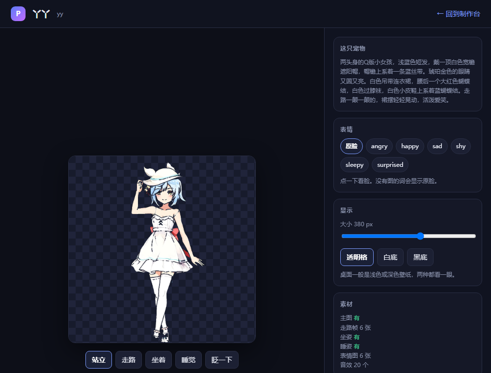

<div align="center">

# Pet Pack Studio

**把一张全身图变成一个能在 Coopanion 里走、坐、睡、做表情的宠物包。**

不用手写 `figure.json`，不用 Blender，不用 3D 建模。

[](https://github.com/qq1402094463/coopanion-pet-pack-studio)


</div>

> **这个分支是什么**
>
> 这是一个**社区工具**的镜像分支，不是 Coopanion 官方的一部分，
> 与 Pal-AI-Lab 没有隶属关系。
>
> 官方主线在这里 👉 **[main 分支](https://github.com/Pal-AI-Lab/Coopanion)**（源码、发行版、issue 都在那边）
>
> 本分支只是加了一个 `tools/pet-pack-studio/` 目录，方便从 fork 列表直接点进来。
> 工具本身是独立 MIT 项目，主仓库地址见上方徽章。

---

## 解决什么问题

Coopanion 的形象包是一套约定：`figure.json` 清单 + `figure.js` 渲染代码 + 贴图 + 音效。
官方文档写得清楚，但真动手时有三个坎：

1. **清单有一堆硬规则**，写错一条整包被拒，错误信息是中文但不说哪里错
2. **一张正面图做不出走路**，得自己画帧，或拍视频抽帧
3. **表情要单独做**，贴错位置就变成「只会原地晃的贴纸」

这个工具把这三件事变成点按钮。

## 一张图能做出什么

| 素材 | 怎么得到 |
|---|---|
| 主图 `body.png` | 你自己画或生成的全身图，正面即可 |
| 6 帧走路 | `autogen.py` 从主图直接算：切上下半身、绕髋关节反相旋转、落地压扁、重心左右移 |
| 坐姿 / 睡姿 | `autogen.py` 压缩下半身 + 整体压扁 / 转 90° |
| 18 个表情 | `facegen.py` 只换脸那一小块，其余像素和主图一致，所以切姿势不会闪 |
| 20 条音效 | `autogen.py` 纯代码合成，不联网 |
| 清单 | 任意 OpenAI 兼容接口的大模型来写，也可以手填 |

也可以上传一段走路视频，工具会抽帧、去背景、按人物裁边、对齐到画布底边。

<div align="center">
  
  <br>
  <sub>分区上传：主图 / 走路帧 / 表情图 / 坐姿 / 睡姿 / 音效</sub>
</div>

<br>

<div align="center">
  
  <br>
  <sub>装进 Coopanion 之前就能看站、走、坐、睡、表情、音效</sub>
</div>

## 三分钟跑起来

```bash
git clone https://github.com/qq1402094463/coopanion-pet-pack-studio.git
cd coopanion-pet-pack-studio
pip install -r requirements.txt
```

Windows 双击 `start.bat`；macOS / Linux 跑 `./start.sh`。
浏览器自动打开 `http://127.0.0.1:8848`。

完整步骤见 [INSTALL.md](tools/pet-pack-studio/INSTALL.md)。

## 为什么不做成官方的一部分

工具要读写你的本地文件、要跑 AI 接口、要打包 zip。
放进 Electron 应用里会带来一堆权限和更新问题。
做成一个独立本地服务，你要卸载就删文件夹，不留痕。

## 分支里的内容

```
tools/pet-pack-studio/     ← 全部工具代码，40 个文件
  studio/server.py         本地服务，1000+ 行，只用标准库
  studio/autogen.py        走路帧、坐睡姿、音效合成
  studio/facegen.py        脸区表情生成
  studio/web/              制作界面 + 预览页
  studio/templates/        能直接跑的最小包
  docs/                    格式规范、流程、排错、素材提示词
```

## 许可证边界

| 范围 | 许可证 |
|---|---|
| `tools/pet-pack-studio/` | **MIT**（见该目录下的 LICENSE） |
| 本仓库其余部分（Coopanion 源码） | **AGPL-3.0**（见顶层 LICENSE） |

工具是独立实现，没有复制 Coopanion 源码。
放在同一个仓库里只是为了方便查找，两部分许可证各自独立生效。

---

<div align="center">
<sub>遇到问题先看体检报告和常见错误对照表，都在 <code>tools/pet-pack-studio/docs/</code></sub>
</div>
